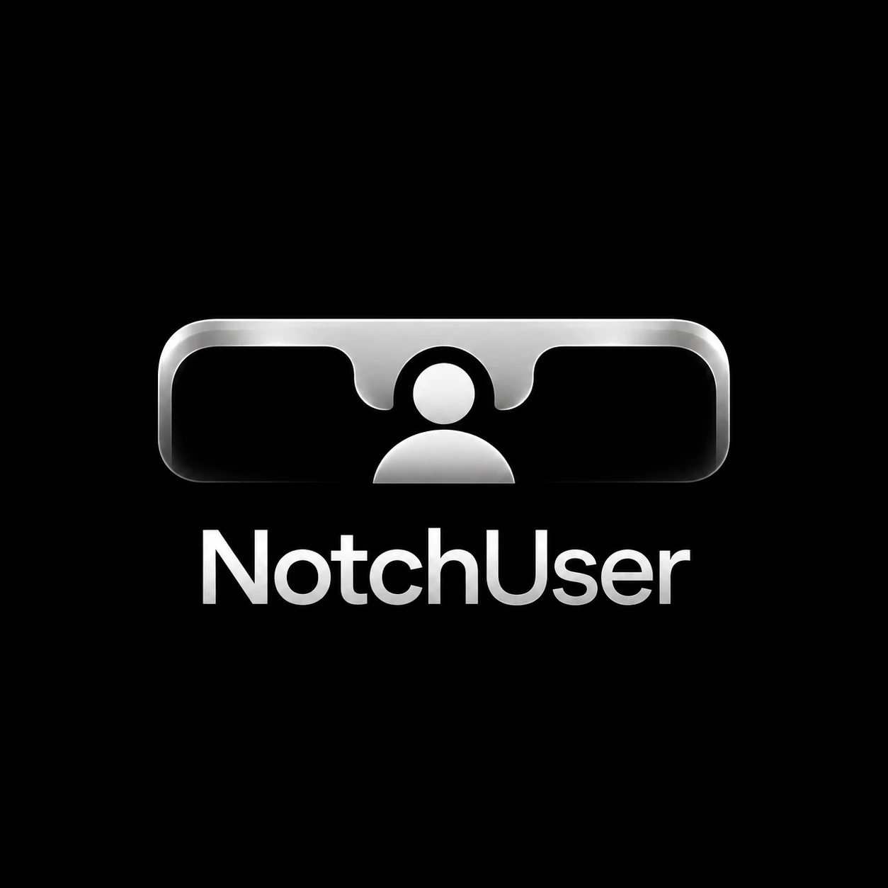
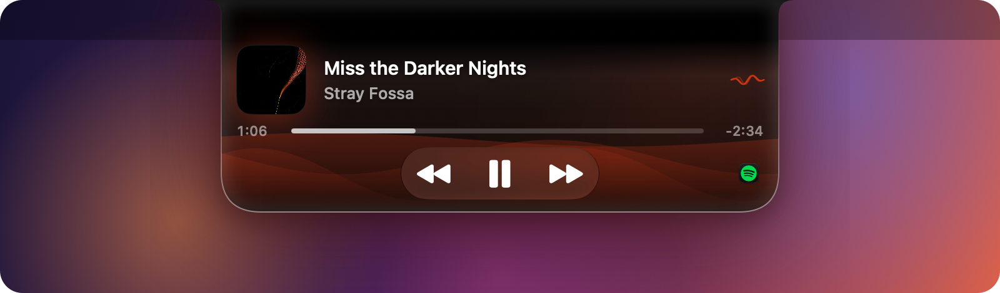
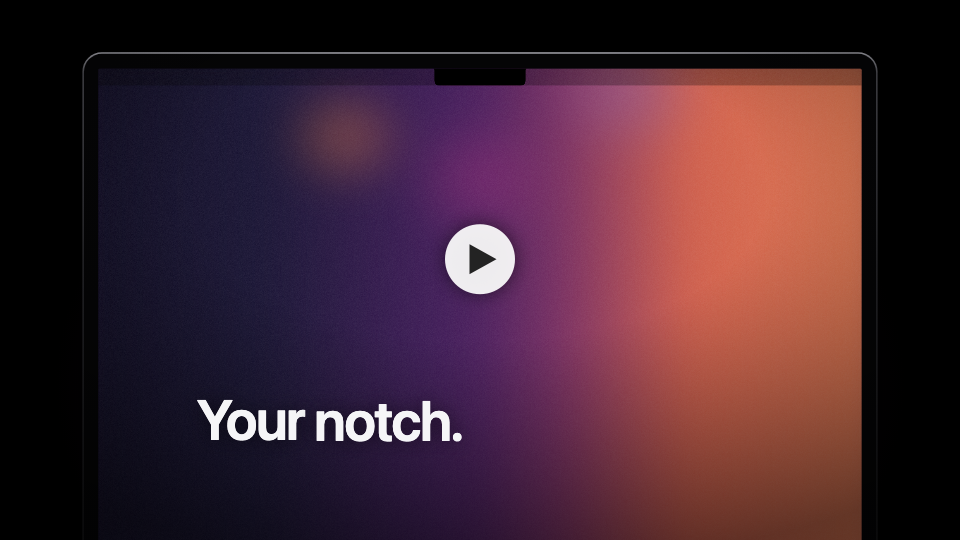
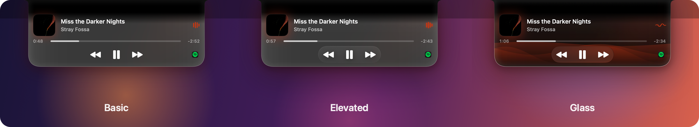
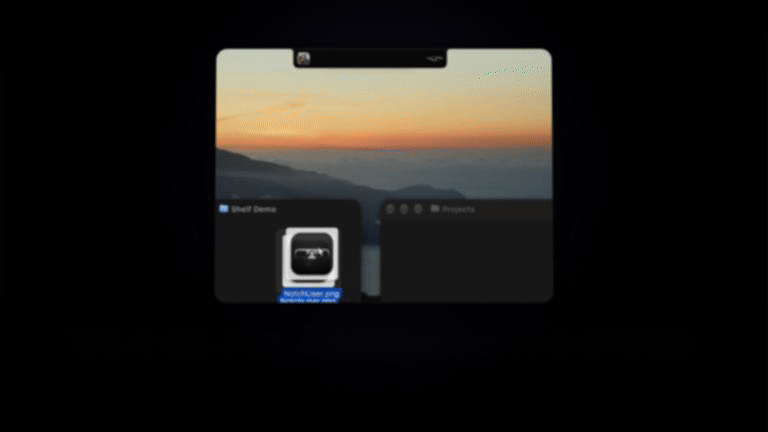

<p align="center">
  
</p>

<h3 align="center">Your MacBook's notch, finally useful.</h3>

<p align="center">
  Music, synced lyrics, a file shelf, and live activities for your builds and AI agents, right under the camera.<br>
  Native, featherweight, free and open source. No account, no tracking, no subscription.
</p>

<p align="center">
  <a href="../../releases/latest"></a>
  <a href="../../releases"></a>
  
  
  
  <a href="LICENSE"></a>
  <a href="../../stargazers"></a>
</p>

<p align="center">
  <a href="../../releases/latest/download/NotchUser.zip"><b>⬇ Download NotchUser for Mac</b></a>
  &nbsp;·&nbsp;
  <a href="README.pt-BR.md">Leia em português</a>
</p>

<p align="center">
  
</p>

<p align="center">
  <a href="Assets/video/NotchUser-Promo.mp4"></a>
  <br><sub>🎬 <a href="Assets/video/NotchUser-Promo.mp4"><b>Watch the 30-second film</b></a></sub>
</p>

---

## Why NotchUser

The notch is dead space in the middle of your menu bar. NotchUser turns it into the most useful spot on your screen, and it looks like Apple put it there.

- **Hover, and it opens.** Cover, progress and controls grow out of the notch and slip back in when you leave.
- **Your AI agents report to it.** Claude Code, Codex and Copilot show what they're doing, you **approve their commands or answer their questions right in the notch**, and when they finish it opens with **what they did**.
- **Your builds too.** `npm`, Xcode, `cargo`, `docker`, `git push`… show up on their own, with a check or a cross when they end.
- **A shelf for everything in transit.** Drop files, links or text on it, drag them out wherever they go.
- **Light enough to forget.** About **0.1% CPU and 30–50 MB** with music playing. The animations run in Core Animation, inside macOS.

## New in 1.7

When Claude Code or Codex finishes, the notch opens with its logo, what you asked and a short summary of what it did. One click takes you back to the app.

## New in 1.6

| | |
| --- | --- |
| 🤖 **AI agents in the notch** | Claude Code, Codex and Copilot: working, waiting for you, finished. Allow or deny a command, or pick an answer to a question, while the music keeps playing. One click to connect each one. |
| 🔨 **Live activities** | Builds, tests, installs and deploys appear by themselves, wherever they were started. `notch run <command>` follows anything else. |
| 🎤 **Synced lyrics** | A lyrics button in the player: the words scroll beside it, the line being sung lit up, the album's color behind. Optional, and also in the closed notch if you want it. |
| 🔊 **Volume and pages** | A volume slider that opens under the mouse. When the notch fills up, music, shelf and activities turn into pages with dots. |
| ✨ **Motion** | The notch oozes out of the bezel and back in. Pick Minimal, Calm, Fluid or Lively, the speed, and the size. |
| 🧰 **More add-ons** | Gestures for volume and songs, mic indicator and global mute (⌃⌥M), pause when the lid is lowered, haptic pulses, a glow at the screen edges, quick actions on the shelf. |

## Three styles

<p align="center">
  
</p>

**Basic** is pure black, like part of the hardware. **Elevated** adds depth, a glow in the album's color and a cover that tilts toward the mouse. **Glass** is Apple's Liquid Glass (macOS 26+) with waves that follow the music.

## Everything it does

**Music:** Spotify, Apple Music and anything playing in the browser. Scrubbable progress, controls, volume, synced lyrics, switching between sources.

**Shelf:** files, links and text with thumbnails, multi-select drag out, AirDrop, and quick actions (convert to JPEG/PNG, half size, text from an image, compress a video, ZIP).

<p align="center">
  
</p>

**AI agents and dev work:** Claude Code, Codex (app and CLI) and Copilot (VS Code and CLI) connect from **Settings → Add-ons**. Builds are detected automatically. From the Terminal:

```bash
notch run npm test              # follow any command until it ends
notch notify "Deploy ok"        # a short message
notch progress build 40         # your own activity, with progress
```

**Optional add-ons** (off until you turn them on): copy text from the screen (⌘⇧2), camera mirror, Bluetooth headphones in high quality, gestures on the notch, mic indicator and mute, pause on lid close, synced lyrics.

**And also:** a pill on external displays, English / Português / Español, and a welcome tour that sets everything up in one go.

<p align="center">
  
</p>

## Install

1. Download **[NotchUser.zip](../../releases/latest/download/NotchUser.zip)**, unzip it, and drag **NotchUser.app** to **Applications**.
2. It isn't signed with a paid Apple account, so the first time: **right-click the app → Open → Open** (or **System Settings → Privacy & Security → Open Anyway**). If macOS says it's "damaged":
   ```bash
   xattr -dr com.apple.quarantine /Applications/NotchUser.app
   ```
3. The welcome tour does the rest.

Requires **macOS 14 Sonoma or later**, Apple Silicon or Intel.

## Privacy

- **No account, no analytics, no tracking.**
- Network requests: the Spotify cover art (from Spotify), and, only if you turn lyrics on and open them, the song's title, artist and length to [LRCLIB](https://lrclib.net), a free lyrics database.
- Agents and activities stay on your Mac: they talk to the notch through local files. Connecting an agent only adds NotchUser's hooks to its settings, after a backup.
- Text recognition runs on your Mac and the image is deleted right away. Every permission is asked only by the feature that needs it.

## Performance

| With music playing | Notch closed | Notch open |
| --- | --- | --- |
| CPU | ~0.1% | only what's on screen updates |
| Memory | 30–50 MB | — |

The bars, waves and spinners are played by Core Animation, lyrics wait for the next line instead of ticking, and the mouse is checked 4 times a second when it's far from the notch.

## Also for Linux and Windows

- **Ubuntu and other GNOME distros:** [NotchUser-Linux](https://github.com/Magnumja/NotchUser-Linux)
- **Windows 10/11:** [NotchUser-Windows](https://github.com/Magnumja/NotchUser-Windows)

## Build from source

Only the Xcode Command Line Tools are needed (`xcode-select --install`).

```bash
zsh build.sh            # build, install into /Applications and open
zsh build.sh release    # build dist/NotchUser.zip
```

`main.swift` is the whole app, `helper.m` reads the system's Now Playing, and `Tools/notch` is the Terminal command.

**About browser music:** since macOS 15.4 only Apple's apps may read "Now Playing". Like other notch apps, NotchUser does it through a small helper loaded by Apple's `/usr/bin/perl`. It changes no system setting, but Apple could close the path in an update; Spotify and Apple Music would keep working.

## Contributing

Issues and pull requests are welcome: bugs, ideas, translations. If NotchUser made your notch useful, **a ⭐ helps other people find it.**

## License

[MIT](LICENSE). Use it, change it, share it.
