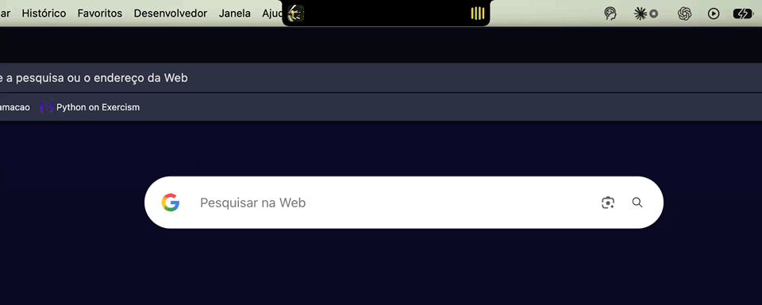

<p align="center">
  
</p>


<p align="center">
  Sua música e uma prateleira de arquivos no notch do seu Mac.<br>
  Nativo, leve, gratuito e de código aberto.
</p>

> 🐧 Usa Ubuntu ou outro Linux com GNOME? Tem a versão para a barra de cima: [NotchUser-Linux](https://github.com/Magnumja/NotchUser-Linux).

---

<p align="center">
  
</p>

## O que ele faz

- **Player no notch.** Passe o mouse no notch e ele abre com capa, título, barra de progresso e controles. Funciona com Spotify, Apple Music e **qualquer coisa tocando no navegador** (YouTube, SoundCloud…).
- **Várias fontes ao mesmo tempo.** Mostra o que começou a tocar por último; os ícones no canto deixam trocar entre os apps.
- **Prateleira.** Arraste arquivos, links ou texto até o notch para guardar; depois arraste para onde quiser (WhatsApp, e-mail, Finder…). Selecione vários e arraste todos juntos, ou mande por AirDrop.
- **Telas externas.** Em monitores sem notch aparece uma pílula no topo com tudo isso.
- **Avisos discretos.** Quando a música troca, o notch abre por alguns segundos e dá um "pulinho".
- **Português, English e Español.** Escolha o idioma na tela de boas-vindas ou deixe seguir o idioma do Mac.

## Instalar

1. Baixe o `NotchUser.zip` na página de [Releases](../../releases) e descompacte.
2. Arraste o **NotchUser.app** para a pasta **Aplicativos**.
3. **Primeira abertura:** como o app não é assinado por um desenvolvedor pago da Apple, o macOS vai bloquear. Clique com o **botão direito → Abrir → Abrir**.
   Se aparecer "está danificado", rode isto no Terminal e abra de novo:
   ```bash
   xattr -dr com.apple.quarantine /Applications/NotchUser.app
   ```
4. Uma **apresentação rápida** mostra o que o app faz, deixa escolher o idioma e pede **todas as permissões num lugar só** (Spotify, Apple Music, Câmera e Gravação de Tela). Todas são opcionais. Se você liberar a Gravação de Tela, o app se reabre sozinho no final para ativá-la.

Para mudar tudo depois: botão direito no notch → **Ajustes…**.

Requisitos: macOS 14 (Sonoma) ou mais novo, Apple Silicon ou Intel.

## Usar

| Onde | O que fazer |
| --- | --- |
| Notch | Passe o mouse para abrir · botão direito para opções, **Ajustes…** e **Sair** |
| Capa do álbum | Clique para abrir o app que está tocando |
| Ícones no canto do player | Trocar entre Spotify, navegador, Música… |
| Prateleira | Clique para selecionar · dois cliques para abrir · arraste para fora · botão direito para Copiar, AirDrop, Mostrar no Finder |

## Compilar a partir do código

Só precisa das Command Line Tools do Xcode (`xcode-select --install`), não do Xcode completo.

```bash
./build.sh            # compila, instala em /Applications e abre
./build.sh release    # gera dist/NotchUser.zip para distribuir
```

Arquivos:

- `main.swift`: o app inteiro (SwiftUI + AppKit).
- `helper.m`: lê o "Tocando agora" do sistema (veja abaixo).
- `Tools/make_icon.swift`: gera o ícone do app a partir de `Assets/logo.png`.
- `Tools/make_gif.swift`: transforma uma gravação de tela no GIF deste README.

## Como ele lê a música do navegador

Desde o macOS 15.4 a Apple só deixa os próprios apps dela lerem o "Tocando agora" do sistema (o framework privado MediaRemote). O NotchUser usa o mesmo truque de outros apps de notch: um pequeno helper (`helper.m`) é carregado pelo `/usr/bin/perl`, que é assinado pela Apple, e repassa título, artista, tempo e capa para o app. Ele não mexe em nenhuma configuração do sistema.

**Aviso:** é um caminho não oficial e a Apple pode fechá-lo numa atualização. Se isso acontecer, o NotchUser continua funcionando com Spotify e Apple Music (via AppleScript); só a parte do navegador para.

## Licença

[MIT](LICENSE). Use, modifique e compartilhe à vontade.
