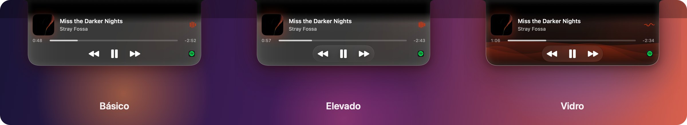

<p align="center">
  
</p>

<h3 align="center">O notch do seu MacBook, finalmente útil.</h3>

<p align="center">
  Música, letras sincronizadas, uma prateleira de arquivos e atividades ao vivo dos seus builds e agentes de IA, logo abaixo da câmera.<br>
  Nativo, levíssimo, gratuito e de código aberto. Sem conta, sem rastreamento, sem assinatura.
</p>

<p align="center">
  <a href="../../releases/latest"></a>
  <a href="../../releases"></a>
  
  
  <a href="LICENSE"></a>
  <a href="../../stargazers"></a>
</p>

<p align="center">
  <a href="../../releases/latest/download/NotchUser.zip"><b>⬇ Baixar o NotchUser para Mac</b></a>
  &nbsp;·&nbsp;
  <a href="README.md">Read in English</a>
</p>

<p align="center">
  
</p>

<p align="center">
  <a href="Assets/video/NotchUser-Promo.mp4"></a>
  <br><sub>🎬 <a href="Assets/video/NotchUser-Promo.mp4"><b>Assista ao filme de 30 segundos</b></a></sub>
</p>

---

## Por que o NotchUser

O notch é um espaço morto no meio da barra de menus. O NotchUser transforma ele no lugar mais útil da tela, e parece que foi a Apple que colocou ali.

- **Passou o mouse, abriu.** Capa, progresso e controles saem do notch e voltam pra dentro quando você sai.
- **Seus agentes de IA falam com ele.** Claude Code, Codex e Copilot mostram o que estão fazendo, você **aprova comandos ou responde perguntas direto no notch**, e quando terminam ele abre com **o que eles fizeram**.
- **Seus builds também.** `npm`, Xcode, `cargo`, `docker`, `git push`… aparecem sozinhos, com um ✓ ou um ✕ quando terminam.
- **Uma prateleira pra tudo que está de passagem.** Solte arquivos, links ou texto nela e arraste pra onde precisar.
- **Tão leve que dá pra esquecer.** Cerca de **0,1% de CPU e 30–50 MB** com música tocando. As animações rodam no Core Animation, dentro do macOS.

## Novidades da 1.7

Quando o Claude Code ou o Codex termina, o notch abre com o logo dele, o que você pediu e um resumo curto do que ele fez. Um clique leva de volta ao app.

## Novidades da 1.6

| | |
| --- | --- |
| 🤖 **Agentes de IA no notch** | Claude Code, Codex e Copilot: trabalhando, esperando você, terminou. Permita ou negue um comando, ou escolha a resposta de uma pergunta, com a música tocando. Um clique pra conectar cada um. |
| 🔨 **Atividades ao vivo** | Builds, testes, instalações e deploys aparecem sozinhos, de onde quer que tenham começado. `notch run <comando>` acompanha qualquer outra coisa. |
| 🎤 **Letras sincronizadas** | Um botão de letra no player: a letra rola ao lado, o verso cantado em destaque, a cor do álbum ao fundo. Opcional, e também no notch fechado se você quiser. |
| 🔊 **Volume e páginas** | Um controle de volume que abre sob o mouse. Quando o notch enche, música, prateleira e atividades viram páginas com pontinhos. |
| ✨ **Movimento** | O notch sai da borda e volta pra dentro como um líquido. Escolha Mínima, Suave, Fluida ou Viva, a velocidade e o tamanho. |
| 🧰 **Mais complementos** | Gestos de volume e música, indicador e mudo global do microfone (⌃⌥M), pausar ao baixar a tampa, pulsos táteis, brilho nas bordas da tela, ações rápidas na prateleira. |

## Três estilos

<p align="center">
  
</p>

**Básico** é preto puro, como parte do hardware. **Elevado** ganha profundidade, um brilho na cor do álbum e a capa que inclina na direção do mouse. **Vidro** é o Liquid Glass da Apple (macOS 26+), com ondas que seguem a música.

## Tudo o que ele faz

**Música:** Spotify, Apple Music e qualquer coisa tocando no navegador. Progresso que dá pra arrastar, controles, volume, letras sincronizadas e troca entre fontes.

**Prateleira:** arquivos, links e texto com miniaturas, vários de uma vez, AirDrop e ações rápidas (converter pra JPEG/PNG, reduzir pela metade, texto da imagem, comprimir vídeo, ZIP).

<p align="center">
  
</p>

**Agentes de IA e programação:** Claude Code, Codex (app e CLI) e Copilot (VS Code e CLI) se conectam em **Ajustes → Complementos**. Builds são detectados sozinhos. No Terminal:

```bash
notch run npm test              # acompanhe qualquer comando até terminar
notch notify "Deploy ok"        # uma mensagem curta
notch progress build 40         # sua própria atividade, com progresso
```

**Complementos opcionais** (desligados até você ligar): copiar texto da tela (⌘⇧2), espelho de câmera, fone Bluetooth em alta qualidade, gestos no notch, indicador e mudo do microfone, pausar ao baixar a tampa, letras sincronizadas.

**E mais:** uma pílula em telas externas, Português / English / Español e uma apresentação que configura tudo de uma vez.

<p align="center">
  
</p>

## Instalar

1. Baixe o **[NotchUser.zip](../../releases/latest/download/NotchUser.zip)**, descompacte e arraste o **NotchUser.app** pra **Aplicativos**.
2. Ele não é assinado por uma conta paga da Apple, então na primeira vez: **botão direito no app → Abrir → Abrir** (ou **Ajustes do Sistema → Privacidade e Segurança → Abrir Mesmo Assim**). Se aparecer que está "danificado":
   ```bash
   xattr -dr com.apple.quarantine /Applications/NotchUser.app
   ```
3. A apresentação faz o resto.

Requer **macOS 14 Sonoma ou mais novo**, Apple Silicon ou Intel.

## Privacidade

- **Sem conta, sem estatísticas, sem rastreamento.**
- Conexões de rede: a capa do Spotify (dos servidores do Spotify) e, só se você ligar as letras e abrir, o nome da música, o artista e a duração pro [LRCLIB](https://lrclib.net), um banco de letras gratuito.
- Agentes e atividades ficam no seu Mac: conversam com o notch por arquivos locais. Conectar um agente só adiciona os hooks do NotchUser nos ajustes dele, depois de um backup.
- O reconhecimento de texto roda no seu Mac e a imagem é apagada na hora. Cada permissão só é pedida pelo recurso que precisa dela.

## Desempenho

| Com música tocando | Notch fechado | Notch aberto |
| --- | --- | --- |
| CPU | ~0,1% | só atualiza o que está na tela |
| Memória | 30–50 MB | — |

Barrinhas, ondas e indicadores são animados pelo Core Animation, as letras esperam o próximo verso em vez de ficar contando, e longe do notch o mouse é checado só 4 vezes por segundo.

## Também para Linux e Windows

- **Ubuntu e outras distribuições com GNOME:** [NotchUser-Linux](https://github.com/Magnumja/NotchUser-Linux)
- **Windows 10/11:** [NotchUser-Windows](https://github.com/Magnumja/NotchUser-Windows)

## Compilar a partir do código

Só precisa das Command Line Tools do Xcode (`xcode-select --install`).

```bash
zsh build.sh            # compila, instala em /Applications e abre
zsh build.sh release    # gera dist/NotchUser.zip
```

`main.swift` é o app inteiro, `helper.m` lê o "Tocando agora" do sistema e `Tools/notch` é o comando do Terminal.

**Sobre a música do navegador:** desde o macOS 15.4 só os apps da Apple podem ler o "Tocando agora". Como outros apps de notch, o NotchUser faz isso por um pequeno helper carregado pelo `/usr/bin/perl` da Apple. Não mexe em nenhuma configuração do sistema, mas a Apple pode fechar esse caminho numa atualização; o Spotify e o Apple Music continuariam funcionando.

## Contribuir

Issues e pull requests são bem-vindos: bugs, ideias, traduções. Se o NotchUser deixou seu notch útil, **uma ⭐ ajuda outras pessoas a encontrarem ele.**

## Licença

[MIT](LICENSE). Use, modifique e compartilhe à vontade.
